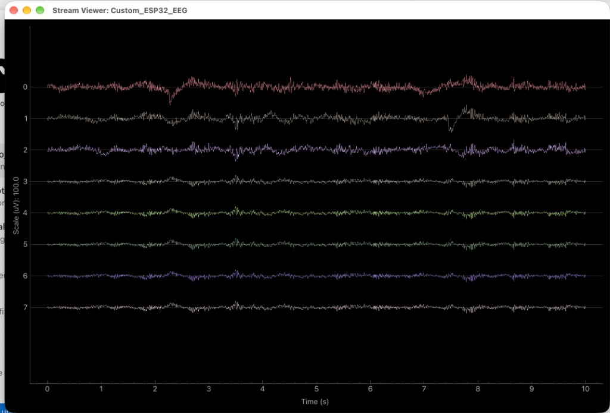
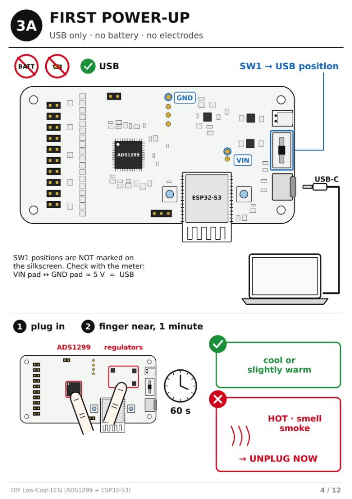
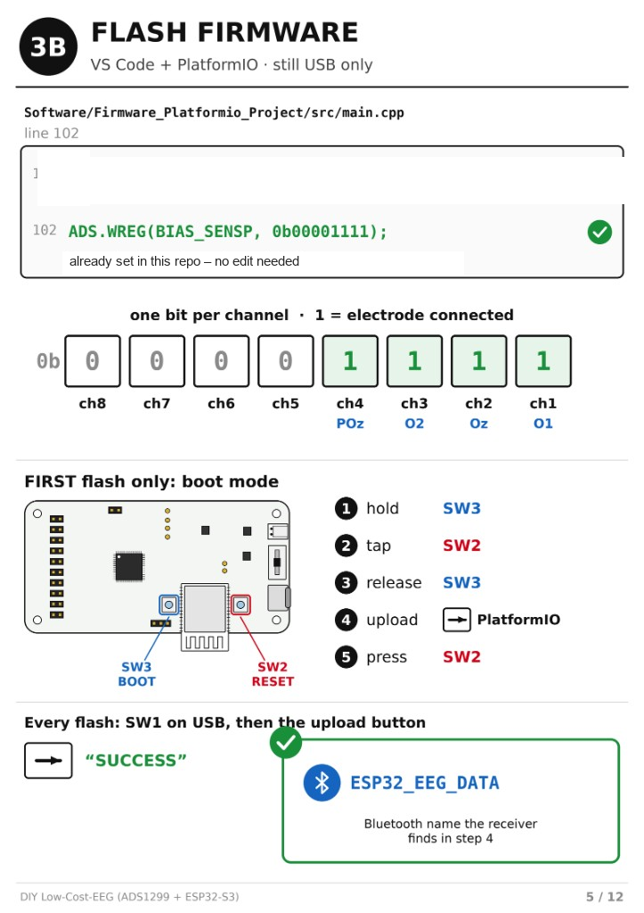
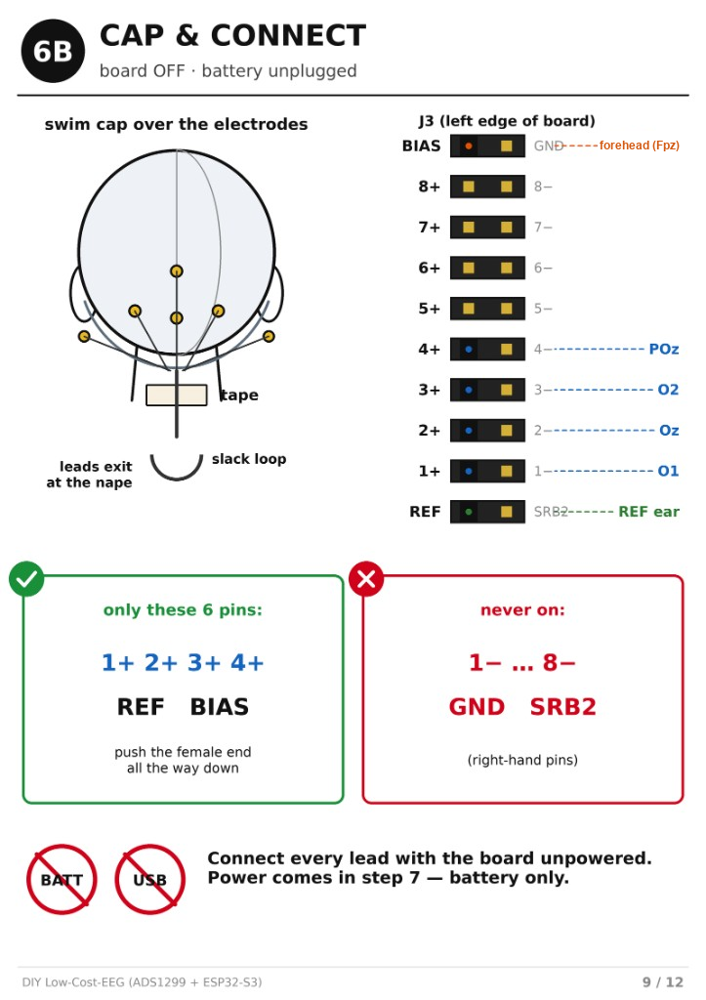
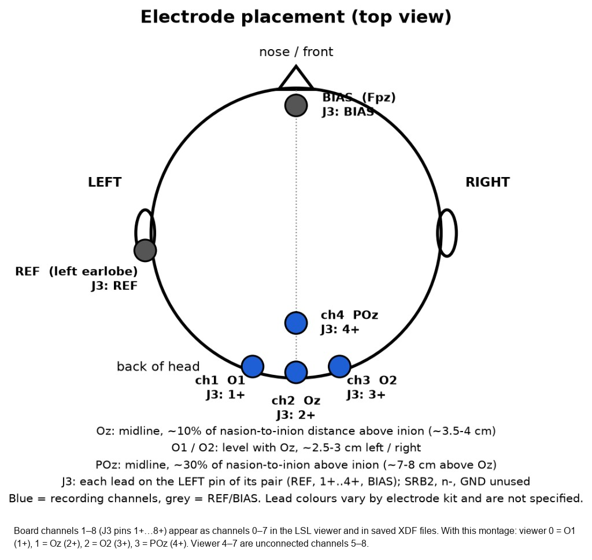

# Figures

These are the setup sheets and one live viewer capture. Checked against the firmware in `Software/Firmware_Platformio_Project/src/main.cpp` and the board notes in `Manufacturing/JLCPCB/ORDER_NOTES.md`.

Board channels 1–8 (J3 pins 1+…8+) appear as channels 0–7 in the LSL viewer and in saved XDF files. With this montage: viewer 0 = O1 (1+), 1 = Oz (2+), 2 = O2 (3+), 3 = POz (4+), 4 = Fz (5+). Viewer 5–7 are unconnected channels 6–8.

The firmware only defines the BIAS pin. The skin site is a montage choice, and this repo uses the forehead (Fpz). REF stays on the left earlobe.

| Viewer / XDF | Board pin | This montage |
| --- | --- | --- |
| 0 | J3 1+ | O1, left |
| 1 | J3 2+ | Oz, midline |
| 2 | J3 3+ | O2, right |
| 3 | J3 4+ | POz |
| 4 | J3 5+ | Fz |
| 5–7 | J3 6+–8+ | not used |

`diy-eeg-alpha` prints the summary for viewer channel 0, which is O1 when the head is wired as drawn.

## Live viewer

`mne-lsl viewer` on `Custom_ESP32_EEG`, vertical scale 100 µV, ten seconds. This is the display, with whatever filtering the viewer has on. It is not the saved Berger summary. Channels 0–2 on this capture move more than 3–7.

## First power-up

USB only, no battery, and no electrodes. SW1 is unmarked, and this repo does not yet say which way the actuator sits for USB or for battery. VIN to GND of about 5 V means the switch is in the USB position. If the board gets hot, unplug it.

## Flash

The sheet shows the value already in this repo, `ADS.WREG(BIAS_SENSP, 0b00001111)` at line 102 of `main.cpp`. No edit is needed. That value enables the bias drive from board channels 1–4.

Hold SW3 (BOOT), tap SW2 (RESET), release SW3, then upload. Press SW2 again after a successful upload. The same button hold is needed again whenever the board does not enter the loader, not only on the first flash. The receiver looks for the Bluetooth name `ESP32_EEG_DATA`.

## Cap and connector

The header order matches the board notes: each pair is signal then the unused pin, BIAS/GND, 8+/8−, down to 1+/1−, then REF/SRB2. With this firmware the reference is SRB1, so electrodes go on BIAS, 1+ through 5+ for this montage, and REF. Leave GND, the minus pins, and SRB2 empty. Connect the leads with the board unpowered. The BIAS lead goes to the forehead (Fpz). Fz uses pin 5+. REF goes to the left earlobe.

## Electrode placement

Board channels 1–8 (J3 pins 1+…8+) appear as channels 0–7 in the LSL viewer and in saved XDF files. With this montage: viewer 0 = O1 (1+), 1 = Oz (2+), 2 = O2 (3+), 3 = POz (4+), 4 = Fz (5+). Viewer 5–7 are unconnected channels 6–8.

O1, Oz, O2, and POz are in the usual 10-20 neighbourhood: Oz about 10% of the way from inion toward nasion, O1 and O2 level with Oz, POz about 30% of the way from inion toward nasion. Fz is on the midline, about 30% of the way from nasion toward inion. Distances in centimetres depend on the head. Grey sites are BIAS and REF. Blue sites are the five recording inputs.
